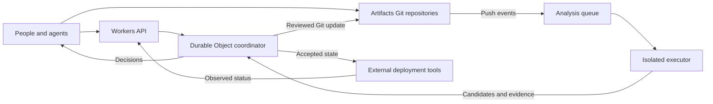
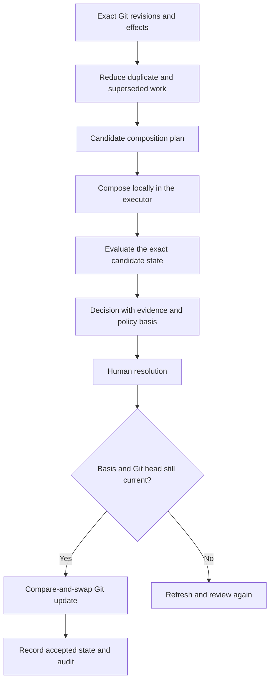

# KLoCGit

KLoCGit helps people and agents work on software at the same time. It combines their changes, checks the result, and shows the choices that need human judgment.

Git stores the code. KLoCGit records the evidence and reasons behind each accepted change.

## System design (HLD)



## Convergence design (LLD)



Candidate trees stay local until promotion. Incomplete required analysis blocks resolution. Deployment tools own rollout and recovery.

## Run locally

Use Node.js 24 and Git.

```sh
git clone https://github.com/vik418/KLoCGit.git
cd KLoCGit
npm ci
LOCAL_ACTOR_ID="$(git config user.email)" npm run dev
```

Open <http://localhost:43187>. Create or import a repository, fork work, and browse its files. The Git email identifies local requests; production requires authenticated identities.

See [CONTRIBUTING.md](CONTRIBUTING.md) for development and checks.
