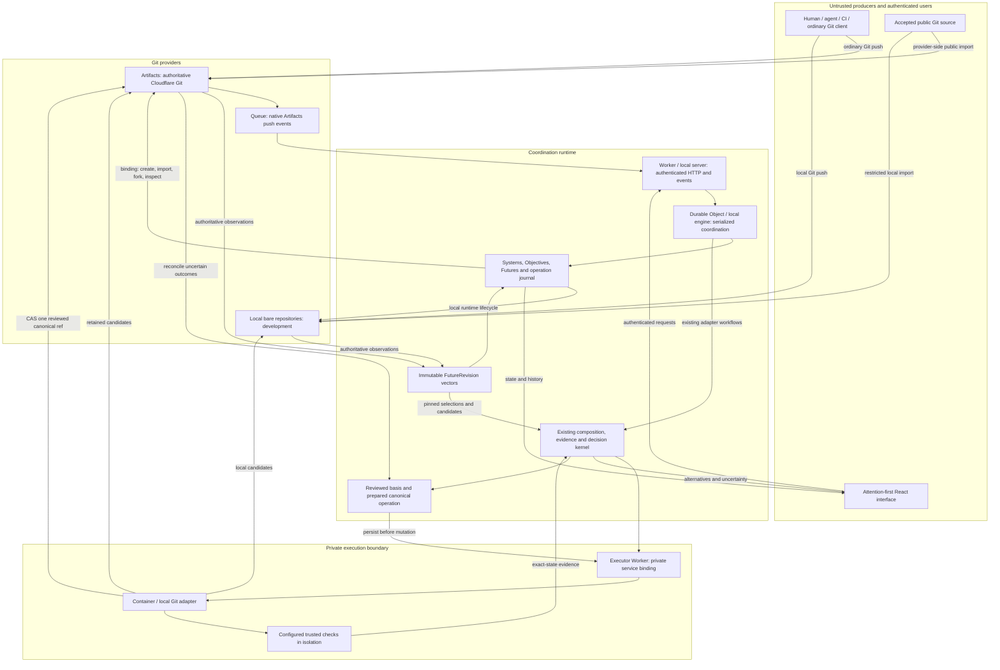

# Design

klocgit v0 manages possible software states. Git owns commits, trees and refs. klocgit owns coordination metadata, immutable observations, decisions and evidence.

The native model is **System → Objective → Future → FutureRevision → Selection → CandidateState → Evidence → Decision → PromotionOperation**. This delivery implements repository/Future lifecycle, whole-Future and commit selections, composed-state validation and single-repository promotion. The existing review kernel remains available as a compatibility adapter. General decision discovery is not delivered.

## Architecture

Solid arrows show implemented responsibilities. Native Future revisions feed the selection/composition service; native and compatibility promotion share the canonical write journal. Cloudflare adapters exist, but the complete live deployment path remains unverified.



The API Worker and Durable Object are the backend. The private executor Worker and Node.js Container perform native Git operations and configured isolated checks. The local Node.js server uses the same domain engine with bare repositories and persisted workspace metadata.

One serialization boundary protects coordination writes. Git's expected-old-head check still protects against external clients. A Durable Object does not make independent repository updates atomic.

## Native state contracts

| Object             | Meaning and current boundary                                                                                                                      |
| ------------------ | ------------------------------------------------------------------------------------------------------------------------------------------------- |
| System             | Logical software and registered repository references. Empty repositories are recorded without inventing commits.                                 |
| Objective          | Optional requested outcome, scope and declared or unknown source. Creating a Future can record the request inline.                                |
| Future             | Mutable workspace identity containing isolated repository copies, exact baselines, producer metadata and a current revision pointer.              |
| FutureRevision     | Immutable repository-head, tree and baseline vectors, affected scope, producer, context reference and provenance state.                           |
| Selection          | Immutable whole-Future or ordered non-merge commit selection pinned to a FutureRevision.                                                            |
| CandidateState     | Immutable repository commits/trees constructed from pinned selections against captured canonical heads.                                              |
| Evidence           | Existing immutable check results pin exact trees, configuration, constraints and dependency versions. Native Git observations are not validation. |
| Decision           | Immutable native acceptance and reviewed basis; compatibility alternatives remain. General discovery is not delivered.                                              |
| PromotionOperation | Shared prepared write journal for native and compatibility decisions. Multi-repository promotion is blocked.                                                              |

Vectors identify repository roles and exact commit/tree inputs; their stable ordering is part of identity. Observation timestamps do not replace version identity. A changed head, rebase, force-push or rewind creates a new FutureRevision. Prior revisions retain their original baselines and provenance.

Context and provenance distinguish **observed, declared, retrieved, inferred and unknown**. Missing context remains unresolved. Unknown authorship is valid ingestion input. Producer declarations cannot authorize validation or canonical writes.

### Repository and Future lifecycle

Create produces an empty Git repository. The first ordinary Git push supplies its initial commit; observation then makes its actual state available as a baseline. Import copies an accepted public repository. A Future forks ready repository states and verifies the pinned commits and trees rather than silently adopting a newer baseline.

The interface starts with repository creation or import. System and Objective metadata are optional secondary actions. Creating a Future does not require a branch, MR, reviewer assignment or a sequence of setup forms.

Every native API mutation requires an authenticated actor and an idempotency key. A replay with the same inputs reuses the recorded operation; reusing the key with different inputs fails. Preparation is persisted before provider mutation. An unknown provider outcome remains visible for authoritative reconciliation. Do not turn an uncertain create or fork into another independent operation.

Git remotes contain no tokens. Returned descriptors do not grant repository access. Artifacts credentials remain scoped and separate from owner, ingress and executor credentials. New repositories do not automatically inherit a trusted executor manifest or validation profile.

### Native API

Routes below have the `/api` prefix.

| Routes                                                                  | Responsibility                                                  |
| ----------------------------------------------------------------------- | --------------------------------------------------------------- |
| `GET /native-state`                                                     | Native catalogue and operation state.                           |
| `GET/POST /systems`, `GET/POST /objectives`                             | Optional logical grouping and requested outcomes.               |
| `GET/POST /repositories`, `POST /repositories/:id/refresh`              | Create, import or adopt; observe the current authoritative ref. |
| `GET/POST /futures`, `POST /objectives/:id/futures`                     | List or create isolated work directly or under an Objective.    |
| `GET /futures/:id`, `GET /futures/:id/revisions`                        | Current identity and immutable history.                         |
| `POST /futures/:id/{observe,abandon}`                                   | Version-checked observation or lifecycle transition.            |
| `GET /repository-requests/:id`, `POST /repository-requests/:id/recover` | Inspect and reconcile a recorded provider operation.            |

Creation accepts a `request_id`; repository mode is `create`, `import` or `adopt`. Future observation and abandonment also pin `expected_version`. A direct Future request can select ready `repository_ids` and include an optional plain-language statement. Selection and candidate routes create exact versions. Separate validation and reviewed promotion routes never trust producer-supplied evidence. `api/openapi.json` documents this v0 HTTP subset; routes whitelist accepted fields and obtain actors from authentication, not request bodies.

The old `POST /repositories/fork` route returns `NATIVE_FUTURE_REQUIRED`; use `POST /futures` to retain baselines, revision history and recovery state. Legacy repository payloads using `name` and `create` must include `request_id` and enter the same prepared operation journal.

## Existing review kernel

MRs, branch proposals, reviews and queue tickets are compatibility workflows. They retain their original histories and revision-specific eligibility. They do not define the native Future lifecycle.

The kernel currently supports exact tree identity, declared alternatives and configured interaction footprints. It forms components from unresolved relationships and validates actual composed trees. Unknown work remains separate. Missing edges and clean textual merges are not proofs of compatibility; there is no general semantic analyzer.

Evidence retains exact inputs after it becomes stale. Changed code, configuration, constraints or relevant dependencies invalidate eligibility. A newer failed, pending or cancelled run cannot be bypassed with an older pass. Producer tests and external declarations are never sole verification. Finite checks establish only their recorded assertions.

Canonical updates authenticate the actor, recheck evidence and policy, compare the reviewed basis and Git head, persist the resolution and prepared operation, then conditionally update Git. A changed basis or head returns `409 DECISION_STALE`; the user must review the changed basis. Reviewed candidates are never silently rebased.

An uncertain canonical write blocks later writes. Recovery observes the authoritative ref and accepts only the exact intended target as applied. The current kernel does not blindly repeat uncertain writes. Reverts construct new inverse candidates with ordinary review, checks and CAS; they do not delete history.

Each current canonical operation advances one repository. Pinned dependencies in other repositories are not distributed locks. Multi-repository Futures do not imply atomic multi-repository promotion. Losing coordination must leave the underlying repositories usable.

## Local development

Use Node.js 24, Git and `npm ci`. The local server defaults to `127.0.0.1:43187` and stores state under `.klocgit-workspace/`. `HOST`, `PORT` and `KLOCGIT_ROOT` override those defaults.

```sh
npm ci
LOCAL_ACTOR_ID="$(git config user.email)" npm run dev
```

`LOCAL_ACTOR_ID` is required. `LOCAL_OWNER_TOKEN` optionally requires a Bearer credential. The browser keeps that credential in page memory. Configure the token before exposing the development server beyond localhost; this is single-owner authentication.

Startup uses an empty workspace. The optional `npm run demo:reset` command replaces the default disposable workspace with sample repositories; stop the server first. It does not reset a custom `KLOCGIT_ROOT`. Backup and restore metadata together with its repositories. Missing metadata beside intact repositories must not trigger destructive initialization.

Executable demo validation additionally needs Linux/WSL, bubblewrap, util-linux and permitted private namespaces:

```sh
sudo apt-get install git bubblewrap util-linux
npm run check
```

The demo contains a payment application and a separate policy contract. Retrying a lost processed response and moving confirmation before replay detection pass alone. Their clean composition duplicates confirmation. Trusted checks observe effects at a simulated provider; producer logs and tests cannot replace those observations.

`npm run test:browser` runs the local desktop/mobile repository and Future smoke flow after installing Playwright Chromium. It covers owner authentication, ordinary Git pushes, immutable observation, dialogs and layout; it does not verify live Cloudflare infrastructure.

`npm run check` runs formatting, lint, tests, the UI build and both Worker dry runs. Real-Git tests cover revisions, dependencies, races and recovery. Dry runs verify bundling, not live event delivery, remote credentials or Container isolation.

## Deployment and trust boundaries

`wrangler.jsonc` defines the `klocgit` API Worker, assets, workspace Durable Object, Artifacts binding and Queue. `wrangler.executor.jsonc` defines `klocgit-git-executor` and its Container. Deploy the executor before the API Worker that binds it.

Wrangler builds the UI before deployment through `build.command`. Workers Builds already installs dependencies, so leave its build command empty. Use `npx wrangler deploy` for production and `npx wrangler preview` for branch previews.

Previews use a new coordinator namespace and the separate `klocgit-preview` Artifacts namespace. Branch previews share that test Git namespace, not production repositories. Configure `AUTH_TOKEN` and `ACTOR_ID` as separate **Previews Base secrets**; production credentials are not inherited. Base secret changes apply to new previews, so update an existing preview's secrets separately.

The Preview lifecycle supports repository creation, import, Futures and manual refresh/observation. It has no Queue consumer or executor binding: automatic push processing, composed checks and promotion are unavailable there. Use a separately deployed staging Worker, Queue, Artifacts namespace and executor to test the complete path. These boundaries follow [Cloudflare's Preview limitations](https://developers.cloudflare.com/workers/previews/resources/#limitations).

The executor uses an operator-owned repository manifest, scoped Git credentials and trusted validation configuration. Observing a new repository does not authorize executing its build scripts or promoting its code. Owner, ingress, executor and per-repository credentials serve separate boundaries.

Public imports accept restricted HTTPS sources. Reject embedded credentials, unsafe URLs and internal addresses. The local importer pins public DNS results, disables redirects, removes inherited secrets and bounds execution. Provider-side import and deployed isolation still require live verification.

Treat repository contents, agents, metadata and generated code as untrusted. Validation rejects unsafe paths, symlinks, submodules and oversized trees. Execution uses read-only candidate/runtime mounts, scrubbed environment, private namespaces and resource limits. Failed isolation must never fall back to direct execution.

Keep prompts, private context, tokens and secrets out of provenance, URLs and logs. Audit history is hash-linked and application-managed; independently enforced immutable retention and signed anchors are not delivered. Organizational authentication, RBAC and SSO are also not delivered.

## Capability and delivery gates

`core/capabilities.mjs` is the authenticated read-only scope registry.

| Status       | Requirement                                                                                                                                          |
| ------------ | ---------------------------------------------------------------------------------------------------------------------------------------------------- |
| VERIFIED     | Defined state, authorization, audit and failure behavior with automated coverage in the stated runtime; live evidence when infrastructure-dependent. |
| PARTIAL      | An implemented subset with explicit missing behavior.                                                                                                |
| EXPERIMENTAL | Integration code whose required operational verification is incomplete.                                                                              |
| UNSUPPORTED  | No delivered operational workflow.                                                                                                                   |

Coverage links locate tests; they are not records of a successful run. Cloudflare support cannot be verified by mocks or bundle dry runs. Current local kernel claims do not establish general semantic correctness or representative decision compression.

Deliver in dependency order: native state lifecycle; selections and exact candidate composition; general evidence; decision discovery; context before work; executable comparison; cross-repository rollout; protocol and scale. Security applies to every stage.

Remaining work includes file/hunk selection and dependency closure, general evaluation and multi-repository promotion, general context retrieval, unseen-work decision discovery, interaction triplets, runtime previews, external evaluators, provider adapters, organizations, SSO/RBAC, quotas, retention, disaster recovery, stable schemas/events and SDKs. These are product requirements, not delivered features.

Gates require ordinary Git interoperability; zero stale, wrong or unauthorized promotions; explicit uncertain recovery; measurable grouping precision/recall; lower human review effort without missed decisions; and inspectable provenance. Include real histories and conventional workflow comparisons rather than optimizing only sample fixtures.

### Decisions requiring measurement

The specification fixes Artifacts, standard Git semantics, immutable state, bounded evidence and conditional promotion. It does not fix every implementation language or scale component.

Git-analysis libraries, execution substrate, query storage, retrieval and mature policy engines are **UNDECIDED for scale**. Benchmark correctness, resource use, isolation, startup, cost, context recall and recovery on representative workloads before selecting them. Keep current native Git and adapters while measuring alternatives.

No proposed new database, custom policy language or distributed transaction is adopted by this delivery. A difficult-to-reverse choice needs an inline proposed ADR recording the problem, requirements, candidates, evidence, tradeoffs, risks and reconsideration trigger.

## Maintenance

Keep domain policy in `core/`, Git/runtime work in adapters, HTTP validation at route boundaries and presentation in `src/`. Prefer cohesive functions, clear names, standard formats and existing dependencies. Comments explain constraints and reasons. Do not simplify away validation or failure handling.

JavaScript public contracts use JSDoc for inputs, outputs and meaningful errors. Python, if introduced, uses type hints and Google-style `Args`, `Returns` and `Raises` docstrings. The design follows the maintainability principles in Dan Vega and Nathaniel Schutta's _Fundamentals of Software Engineering: From Coder to Engineer_ and the [Ponytail simplification ladder](https://github.com/DietrichGebert/ponytail#how-it-works).

Add regression tests for changed behavior, especially stale inputs, authorization, races and recovery. Use real temporary Git repositories for ref semantics. Commit source and necessary fixtures; keep local state, build output, credentials and reports out of Git.

## Native composition

Whole-Future selections pin all repository heads in a Future revision. Commit selections pin one repository and an ordered list of non-merge commits within that revision. Git applies their patches to an index; it does not import unselected parents as candidate ancestry. Textual conflicts fail explicitly. Semantic dependency closure is not established.

A CandidateState records selected revisions, canonical base heads and retained resulting commits/trees. Trusted checks bind each exact repository tree, validation configuration, active constraint versions and dependency heads. Failed latest runs cannot reuse earlier passing evidence.

The review basis covers the candidate, selections, evidence, constraints, configuration, current Future pointers and canonical heads. Promotion verifies both that basis and expected heads, checks source refs directly, then persists an immutable decision and prepared operation before Git CAS. Native and compatibility writes share one journal. Lost replies block further writes; recovery observes the exact target and never repeats CAS.

This version promotes exactly one changed repository. Multi-repository candidates can be composed and validated, but promotion is blocked. Cross-repository atomicity and protection against a dependency changing during the final single-ref write are not claimed. Cloudflare execution still requires operator-owned validation profiles and admission of every source repository to the scoped executor manifest.
