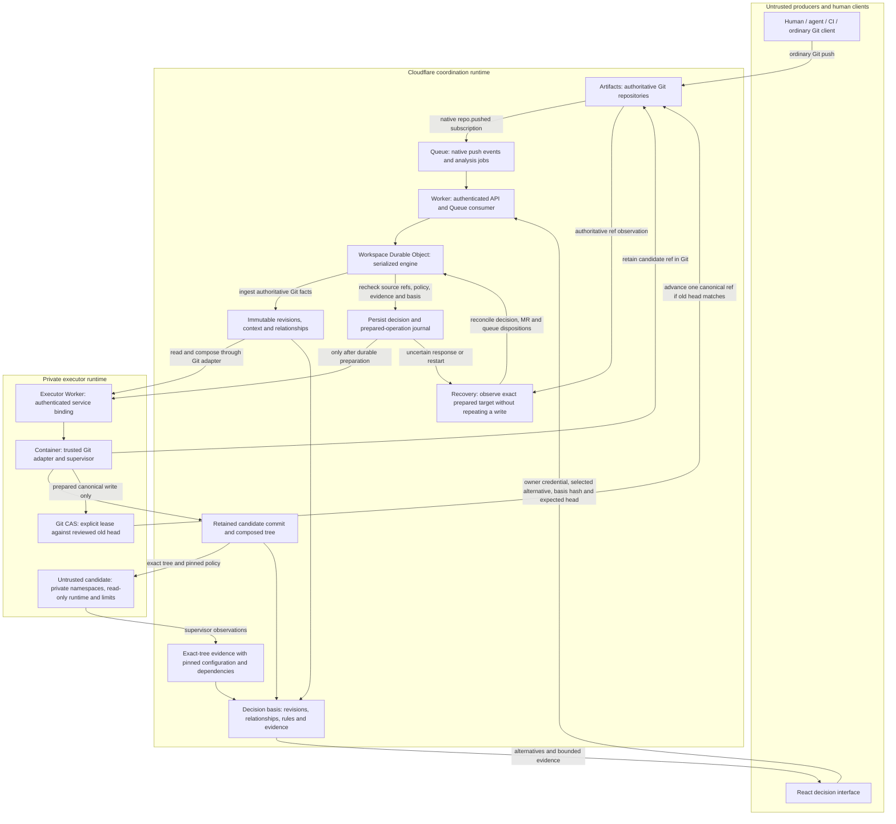

# Design

KLoCGit, pronounced “clock it,” coordinates concurrent Git work through intent, proposal, decision, implementation and evidence. Git owns code; the platform owns coordination metadata. The interface starts with decisions and exposes code, reviews and infrastructure details when needed.

## Architecture

This diagram combines the deployment boundaries with the versioned review and write protocol. The Cloudflare configuration exists; live account behavior still needs verification.



React is the frontend. The API Worker and workspace Durable Object are the backend: they authenticate requests, store coordination state and run domain policy. The private executor Worker and its Node.js Container perform native Git operations and isolated validation. JavaScript runs on both sides; the application is not frontend-only.

The local Node.js server uses the same engine with bare Git repositories and a JSON workspace file. Queue delivery does not order Git history: ingestion rechecks authoritative refs and deduplicates events. The coordinator serializes its own operations; external Git clients remain protected by the Git old-head check.

| Boundary            | Responsibility and implementation                                                                                                                                                              |
| ------------------- | ---------------------------------------------------------------------------------------------------------------------------------------------------------------------------------------------- |
| Domain              | [`core/engine.mjs`](../core/engine.mjs) coordinates context, analysis, evidence, decisions, MRs and queue policy.                                                                              |
| HTTP                | [`server/workflow-api.mjs`](../server/workflow-api.mjs) shares workflow dispatch between local and Worker routes.                                                                              |
| Local runtime       | [`server/local.mjs`](../server/local.mjs), [`server/git.mjs`](../server/git.mjs) and [`server/runner.mjs`](../server/runner.mjs).                                                              |
| Cloudflare runtime  | [`worker/index.mjs`](../worker/index.mjs), [`worker/events.mjs`](../worker/events.mjs), [`worker/artifacts.mjs`](../worker/artifacts.mjs) and [`worker/executor.mjs`](../worker/executor.mjs). |
| Interface           | [`src/app/App.jsx`](../src/app/App.jsx) composes feature views; shared API and hooks manage requests. The browser cannot authorize evidence or Git writes.                                     |
| Fixtures and checks | [`fixtures/application.mjs`](../fixtures/application.mjs), platform-owned [`fixtures/trusted/supervisor.mjs`](../fixtures/trusted/supervisor.mjs) and [`tests/`](../tests/).                   |

## Core model and invariants

A proposal is a logical work history. Each source update creates a content-addressed ProposalRevision with exact base/head commits, tree, affected paths, context and provenance. Rebase and force-push create new revisions. Missing provenance remains valid and visible. Identical trees can share an Implementation reference while keeping separate intent and rationale histories.

Context snapshots, relationships, compositions, evidence and decisions retain immutable input references. Mutable branch pointers, MR lifecycle and evidence eligibility are separate from those records. Producer declarations use `.klocgit/`; `.converge/` remains readable when the current file is absent. Invalid current metadata cannot silently fall back to an older declaration.

Context items distinguish declared, retrieved, observed and inferred information. Checkable constraints may block automation; advisory statements cannot. The current context compiler supports the explicit `retry-response-v1` task, retrieving policy from another repository at a pinned commit. A material answer or explicit assumption creates a snapshot. Waiting for that answer does not block unrelated Git work.

Relationship analysis filters by exact tree identity, affected paths, declared choices and configured validation footprints. Declared alternatives and observed interactions form review groups. It does not discover arbitrary semantic equivalence. Missing relationships do not prove compatibility; a clean textual merge produces a candidate requiring composed-tree validation. There is no LLM integration.

Evidence pins the exact subject/tree, configuration, constraints and dependency heads. External CI is a declaration, not a trusted platform check. A changed input makes old evidence ineligible without deleting its observations. Reruns append results; a newer failed, pending or cancelled result cannot be bypassed by selecting an earlier pass for the same inputs. Finite tests establish only their listed assertions.

Canonical advancement follows [`core/canonical.mjs`](../core/canonical.mjs): authenticate the actor; recheck source refs, MR/dependency policy, current composed-tree evidence and decision basis; persist the decision and prepared operation; then compare-and-set Git against the reviewed head. Local Git uses `update-ref` with the expected old object ID; remote Git uses an explicit `--force-with-lease`. A changed basis or head returns `409 DECISION_STALE`, requiring renewed review.

Candidate commits are retained under `refs/klocgit/candidates/` before remote preparation. Legacy `refs/converge/candidates/` remains readable for recovery. Both namespaces are excluded from producer ingestion. An uncertain write blocks subsequent canonical updates. Recovery accepts only an authoritative ref equal to the exact prepared target; the old base, another commit or a later descendant remains `RECOVERY_REQUIRED`. Recovery never guesses by repeating the Git write.

One operation advances one repository. Other repositories can supply pinned validation dependencies but are not locked against outside pushes; this is not a distributed transaction. Git remains cloneable and usable if coordination fails. Metadata repair must not delete or recreate intact repositories. Record immutability and hash-linked audit history are application-managed, without independently enforced append-only storage or external audit anchoring.

## Workflows and API

**Decisions** shows grouped alternatives. **Work** exposes native MRs, ordinary Git proposals and reviewed queue tickets. Preparing, commenting, validating and discussing work never advances canonical Git.

- MRs track branches in a registered canonical repository or producer fork. Draft/ready, close/reopen and title/description edits retain history; draft and closed work stays outside automatic convergence.
- MR writes pin `expected_version` or event ID; reviews, comments and declared checks also pin `expected_revision_id`. New source commits stale approvals/checks, even when push events arrive late. Source deletion preserves history and withdraws work. External merges require exact source ancestry, not matching trees or messages.
- Repository policy controls approval count, self-approval and required platform checks. The default requires zero separate MR approvals but still requires an explicit reviewed decision. Every included MR must satisfy current policy. Thread resolution is recorded but is not a separate merge gate. Actor identity comes from server authentication, never submitted metadata.
- Single and batch preparation compose actual Git changes, retain a candidate commit and validate it. Ordinary producers need no MR. Applying submits the selected alternative, `basis_hash`, `expected_canonical_head` and rationale.
- Dependencies form a revision-pinned DAG; cycles are rejected and changed prerequisites require redeclaration. A prerequisite must remain in canonical ancestry and must not have a recorded revert. Same-repository dependencies may be selected together.
- Queue tickets pin the reviewed composition, evidence, source/MR/dependency basis and head. Processing applies at most one eligible ticket per invocation. Blocked prerequisites can allow another ticket to proceed. Changed inputs yield `needs_review`; the queue never adopts a refreshed candidate silently. Request replay cannot authorize a second write or a different payload.
- Reverts prepare an inverse against the current head and require ordinary review, validation and CAS. An external merge needs an explicit `mainline` parent. Reverting a batch reverses its entire selected composition. Unrelated later work is preserved where Git can compose the inverse; conflicts require review.

All routes have an `/api` prefix. Inspect the shared dispatcher and [`worker/routes.mjs`](../worker/routes.mjs) for payload validation.

| Routes                                                                               | Purpose                                                                       |
| ------------------------------------------------------------------------------------ | ----------------------------------------------------------------------------- |
| `GET /workspace`, `GET /capabilities`                                                | Current coordination view and scoped support registry.                        |
| `POST /events`, `POST /analysis`                                                     | Ingest Git events; derive or refresh decision components.                     |
| `GET/POST /tasks`, `POST /tasks/:id/answer`, `POST /tasks/:id/assume`                | Context task, material answer or explicit assumption.                         |
| `GET/POST /merge-requests`, `GET /merge-requests/:id`                                | List/open MRs and inspect current/history views.                              |
| `POST /merge-requests/:id/{transition,reviews,comments,checks,dependencies}`         | Versioned lifecycle, review, discussion, declarations and dependency updates. |
| `POST /merge-requests/reviews/batch`                                                 | Preflight several exact reviews.                                              |
| `POST /merge-requests/:id/{validate,prepare}`                                        | Platform validation or review preparation.                                    |
| `GET/POST /repositories/:id/policy`                                                  | Read/update versioned owner rules.                                            |
| `POST /reviews/prepare`, `POST /reverts/prepare`                                     | Compose one/batch revisions or an inverse candidate.                          |
| `POST /decisions/:id/{refresh,resolve}`                                              | Renew review inputs or apply an exact reviewed alternative.                   |
| `GET/POST /merge-queue`, `POST /merge-queue/process`, `POST /merge-queue/:id/cancel` | Inspect, enqueue, process or cancel reviewed tickets.                         |
| `POST /recover`                                                                      | Reconcile uncertain prepared writes without another CAS.                      |

## Local development

Use Node.js 24, `npm ci`, Git and Linux/WSL. Node Git adapters invoke `/usr/bin/git`. Executable validation also needs bubblewrap, util-linux (`prlimit`, `unshare`) and permitted private user/network namespaces:

```sh
sudo apt-get install git bubblewrap util-linux
npm ci
npm run dev
```

Open <http://localhost:43187>. `HOST` defaults to `127.0.0.1`, `PORT` to `43187`, `DECISION_GIT_ROOT` to `.demo-v2/`, and `LOCAL_ACTOR_ID` to `demo-owner`. `LOCAL_OWNER_TOKEN` optionally requires a Bearer credential. If exposing `HOST=0.0.0.0`, configure that token and use a trusted network; the development server is not organizational authentication. The interface keeps its owner credential in page memory.

The workspace contains metadata, bare repositories, baseline copies and producer clones. Use a disposable directory for experiments. The UI reset deletes and recreates that workspace. With the server stopped, `npm run demo:reset` deletes and recreates default `.demo-v2/`; it does not reset a custom `DECISION_GIT_ROOT`. Stop the server before backup/restore and preserve metadata together with repositories. Missing metadata beside existing repositories stops startup rather than overwriting code.

The two sample repositories contain a payment HTTP application and a separate policy contract. Run a cloned checkout with `node app.mjs`; it exposes `/checkout`, `/charge` and `/state`. All effects are simulated. Retrying a lost processed response and sending confirmation before replay detection pass separately, but their clean composition produces duplicate confirmation. The platform supervisor observes effects at a simulated provider; candidate logs or producer tests cannot substitute for those observations.

```sh
npm run format:check
npm run lint
node --test tests/workflow-integration.test.mjs
node --test tests/application.test.mjs
npm run check
```

`format` and `lint:fix` write changes; review them. `check` runs formatting, lint, tests, browser build and both Worker dry runs. Focused real-Git tests cover lifecycle, revisions, dependencies, CAS and recovery. Application tests cover interaction and isolation. Tests use temporary repositories, not the interactive workspace. Worker dry runs verify bundling, not deployment or remote Git. [`core/capabilities.mjs`](../core/capabilities.mjs) records support limits and relevant test files; links are coverage references, not proof of a passing run.

Common errors: `validation-unavailable` requires checking the complete sandbox, not weakening isolation; `DECISION_STALE`/`MR_STALE` requires fresh state and review; `RECOVERY_REQUIRED` requires authoritative recovery; `WORKSPACE_METADATA_MISSING` requires restoring metadata with its repositories. `unshare --user --map-root-user --net true` probes only part of the isolation setup.

## Runtime boundaries

[`wrangler.jsonc`](../wrangler.jsonc) defines the `klocgit` API Worker, static assets, workspace Durable Object, Artifacts namespace and analysis Queue. [`wrangler.executor.jsonc`](../wrangler.executor.jsonc) defines the private `klocgit-git-executor` Worker and Container. Workers handle HTTP and coordination; the Container supplies native Git and isolated validation. Both run in the same account and use the same workspace identifier.

The owner, ingress, private service and repository credentials serve separate trust boundaries. The API authenticates an actor before accepting decisions. The executor receives its repository manifest and scoped tokens through encrypted bindings; candidate code receives neither. Evidence must match the configured trusted validation hash.

A new Worker name creates separate Durable Object storage. Renaming source does not move an existing workspace, Git repository, Queue or subscription. Populated resources require an explicit migration; retained candidate refs and prepared operation history must survive it. Local checks and bundle dry runs do not establish live event delivery, remote CAS, Container recovery or sandbox support.

## Maintenance and security

Keep responsibilities explicit: domain policy in `core/`, Git/runtime work in adapters, HTTP validation in route boundaries and presentation in `src/`. Read the real flow before changing it. Reuse existing code, standard libraries, native platform facilities and installed dependencies before adding abstractions. Choose clear names and small cohesive functions; do not compress safety checks into clever code. New dependencies must solve a concrete maintenance problem.

Design references: [Fundamentals of Software Engineering: From Coder to Engineer](https://www.oreilly.com/library/view/fundamentals-of-software/9781098143220/) by Dan Vega and Nathaniel Schutta, and the [Ponytail simplification ladder](https://github.com/DietrichGebert/ponytail#how-it-works). Favor readable code, small reversible changes, meaningful tests and explicit tradeoffs. Preserve validation, error handling, security and accessibility when simplifying.

Use JSDoc for JavaScript public contracts: inputs, outputs, asynchronous behavior and meaningful errors. Comments explain design reasons and constraints. Python code uses type hints and [Google-style docstrings](https://google.github.io/styleguide/pyguide.html#383-functions-and-methods) with `Args`, `Returns` and `Raises` where applicable.

Add meaningful regression coverage for behavior changes, especially stale inputs, races, policy and failure/recovery. Use actual temporary Git repositories for ref semantics. Avoid tests that mirror implementation or turn sample decision counts into guarantees. Run focused checks during development and `npm run check` before delivery; report unavailable infrastructure accurately. Commit source and necessary fixtures, not local state, build output, screenshots, test reports or credentials.

Treat producer code, metadata and repository contents as untrusted. The runner rejects unsafe paths, symlinks, submodules and oversized trees; execution uses private namespaces, read-only tree/runtime, scrubbed environment, Node permissions and resource limits. Credentials remain outside candidate code and provenance. Never use producer tests or declared CI as sole write authorization, and never replace failed isolation with direct execution.

Keep owner, ingress, executor and per-repository producer credentials separate and scoped. Keep prompts, private context, tokens and secrets out of provenance, URLs and logs. Revoke exposed tokens and verify Container rotation. The current application has one owner, not organizational identity/RBAC. Report vulnerabilities through GitHub’s private Security report when available, otherwise contact the owner privately with redacted reproduction details. There is no published support schedule.

Current limits include registered canonical MR targets only, no reviewer assignment/CODEOWNERS, no arbitrary CI runner, no GitHub/GitLab connectors, and no automatic semantic correctness proof. Relationship filtering scans workspace metadata rather than providing a production-scale index. Applied/deferred outcomes exist; general rejected/superseded workflows do not. Decision compression is a bounded demo result and must count upstream human clarification separately from convergence review.
