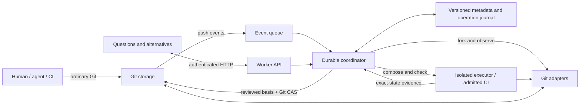

# Design

klocgit coordinates concurrent Git work. Git owns code; klocgit records intent,
possible states, evidence and decisions.

## Architecture

The coordinator orders writes; adapters access providers. Git CAS protects refs.

Cloudflare uses Workers, Queues, a Durable Object, Artifacts and a private Container.
Local development uses the same domain engine with filesystem and Git adapters.

## State model

| Object             | Responsibility                                                           |
| ------------------ | ------------------------------------------------------------------------ |
| System             | Groups repositories belonging to one product.                            |
| Objective          | Records a requested outcome; optional for incoming Git work.             |
| Future             | Isolated repository copies with pinned baselines and a current revision. |
| FutureRevision     | Immutable observed commit/tree vector and provenance.                    |
| Selection          | Whole Future or ordered commits pinned to one revision.                  |
| CandidateState     | Actual composed commits/trees against captured canonical heads.          |
| ContextSnapshot    | Retrieved constraints, explicit answers and unresolved assumptions.      |
| Evidence           | Results bound to exact code, checks, constraints and dependencies.       |
| DecisionComponent  | Choices connected by declarations or observed composition failures.      |
| Decision           | Reviewed state, basis, actor and rationale.                              |
| PromotionOperation | Durable record of a prepared canonical write and its outcome.            |

Canonical state is the accepted Git ref vector. Pushes and rebases create revisions.

## Contracts

- **Version inputs.** Derivations reference immutable revisions, trees, configuration
  and constraint versions. Source changes invalidate eligibility, not history.
- **Separate knowledge.** Declared, observed, retrieved, inferred and unknown data
  remain distinct. Unknown provenance permits ingestion.
- **Validate compositions.** Checks run on the composed state. The latest failed,
  pending or cancelled run cannot reuse an older pass. Passing checks establish
  only their recorded assertions.
- **Promote conditionally.** Recheck source refs, evidence, reviewed basis and expected
  canonical heads. Persist the decision and prepared operation before Git CAS.
  Changed inputs return `409 DECISION_STALE`; review must be refreshed.
- **Recover conservatively.** Uncertain writes block further promotion. Reconciliation
  observes Git without repeating the write. The exact target confirms completion;
  a different ref cannot prove non-application. Operator settlement records a
  declared, audited outcome and never writes Git. Multi-repository promotion is
  non-atomic: each stage has a receipt, and partial application requires fresh
  review to continue or explicit reconciliation to abandon remaining writes.
- **Keep Git usable.** Coordination failure must leave repositories cloneable and
  their history intact. Request identities make retries idempotent.

## Trust and boundaries

Authenticate requests and audit actor identity. Version repository permissions;
revocation invalidates reviewed bases. JWT identity is verified against an admitted
issuer. Internal requests carry a body-bound signed identity.

Treat code and producer claims as untrusted. Operator-owned checks and admitted CI
sign observations about issued, immutable inputs. Producer reports remain declared.
Keep credentials ephemeral and scoped. Failed isolation blocks execution.

## Scope

v0 selects whole Futures and non-merge commits. It validates exact compositions
and records non-atomic multi-repository promotion. Cross-repository atomicity,
semantic dependency closure and arbitrary behavioral equivalence are not established.

Context clarification uses explicit choice/effect annotations; plain text can be
retrieved but is not automatically understood. Unknown work remains visible.
Passing finite checks is evidence for those assertions, not proof of correctness.

File/hunk selection and complete live Cloudflare verification remain unfinished.
Domain policy belongs in `core/`; provider access belongs in adapters.
See `api/openapi.json` for HTTP contracts and `core/capabilities.mjs` for tested scope.
